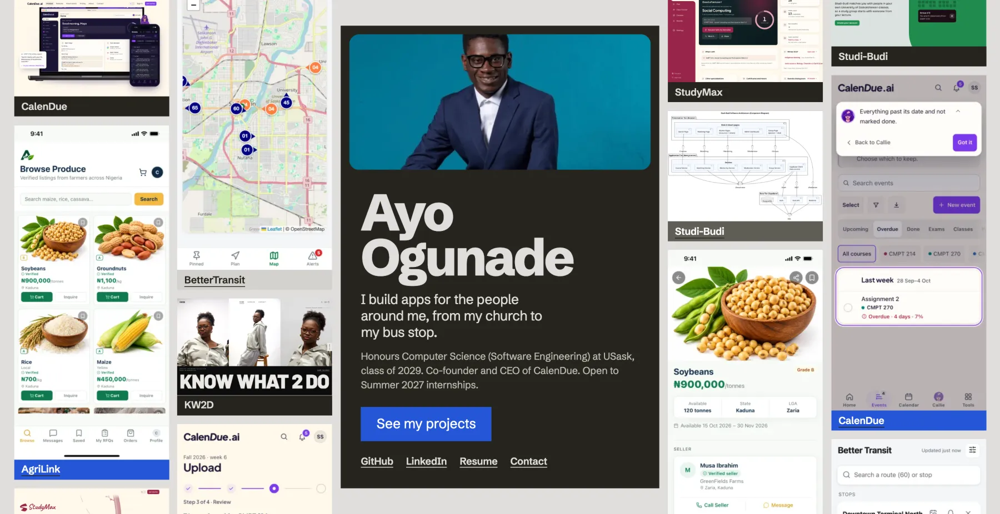
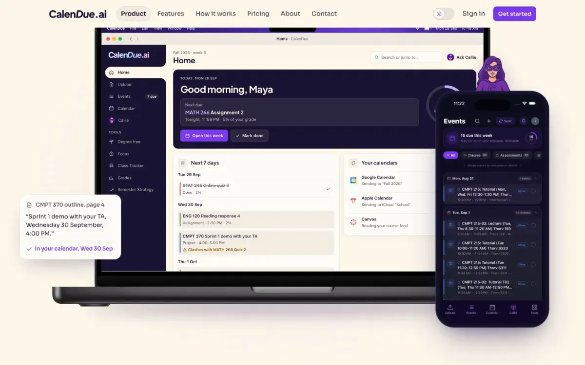
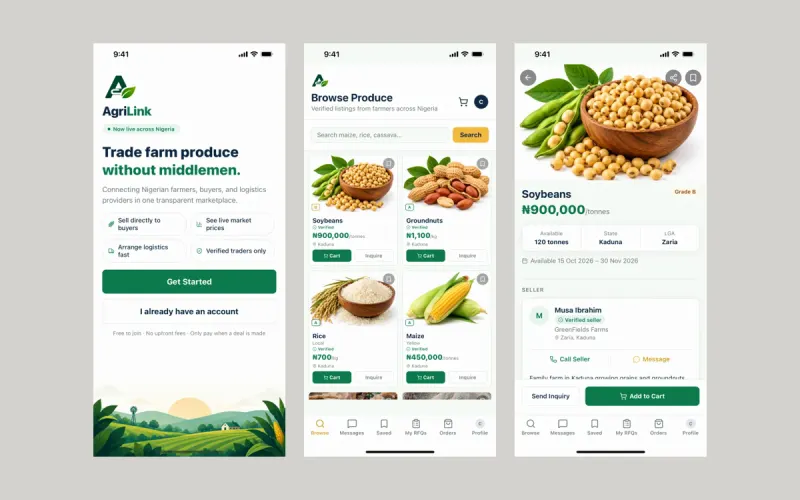
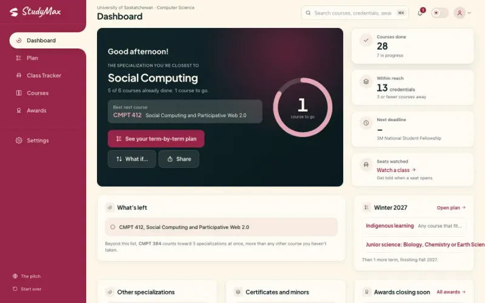
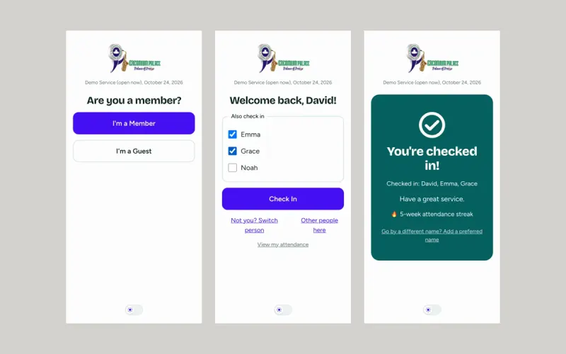
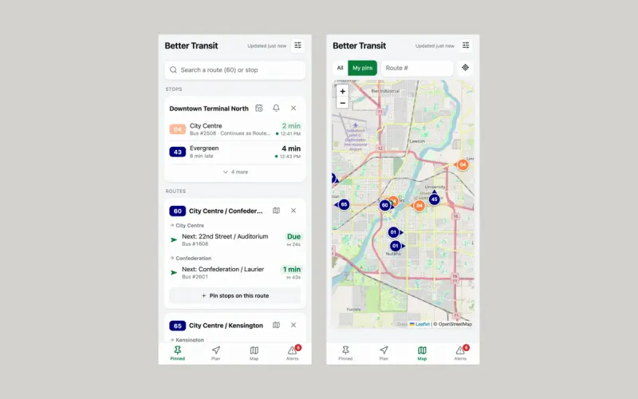
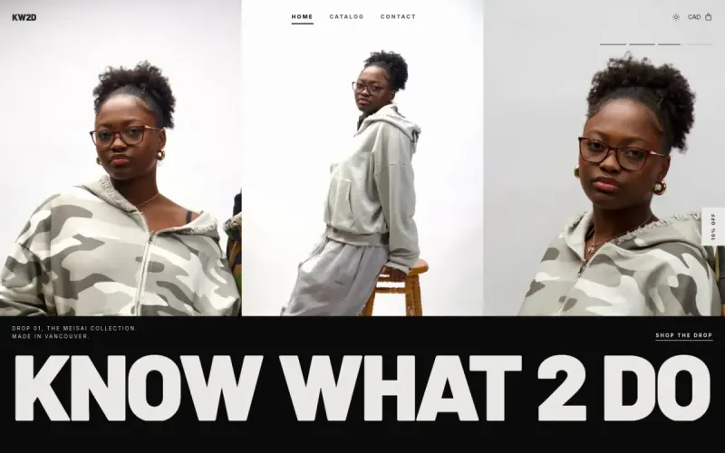
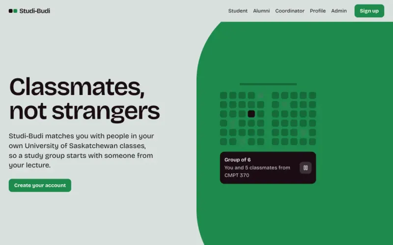

<h1 align="center">Hi, I'm Ayo</h1>

  I build full-stack apps for the people around me, from my church to my bus stop.

   Honours CS (Software Engineering), University of Saskatchewan, 2029
  &nbsp;·&nbsp;
   Co-founder and CEO of <a href="https://www.calendue.ca">CalenDue</a>
  &nbsp;·&nbsp;
   Saskatoon

<b>Open to Summer 2027 software engineering internships.</b>

  
  
  
  

##  Now building: [CalenDue](https://www.calendue.ca)

An AI academic calendar, live on the web, the App Store and Google Play, and used by 150+ students. It started as a **first-place win at CoHack 2025**, a 27-hour hackathon, and is now a startup with a team of four.

- **Syllabus extraction pipeline** for PDF, DOCX, pasted text and exam-schedule tables, with prompt-hash caching
- **Callie**, a course assistant built on RAG: pgvector search with keyword re-ranking, kept separate per course
- **Calendar sync** with Google Calendar (OAuth2), Apple Calendar (CalDAV) and Canvas LMS, with deduplication

`Next.js` `TypeScript` `Supabase` `Prisma` `Expo` `LangChain`

##  Other things I've shipped

<table>
  <tr>
    <td width="33%" valign="top">
      
       <b><a href="https://agrilink-zeta.vercel.app">AgriLink</a></b>
       Nigerian farmers sell produce straight to buyers. Paystack payments are held until delivery. Web and mobile.
       Next.js · Expo · Supabase · Paystack
    </td>
    <td width="33%" valign="top">
      
       <b><a href="https://github.com/Calendue/StudyMax">StudyMax</a></b>
       Reads your transcript and maps the fastest path through your degree. Max, the AI advisor, can call you.
       React · TypeScript · Prisma · Capacitor · Vapi
    </td>
    <td width="33%" valign="top">
      
       <b><a href="https://praisecount.vercel.app">PraiseCount</a></b>
       Check-in for my church: recognises returning phones, checks in whole households, tracks streaks.
       Next.js · PostgreSQL · Prisma · Clerk
    </td>
  </tr>
  <tr>
    <td width="33%" valign="top">
      
       <b>BetterTransit</b>
       Live Saskatoon buses on the city's GTFS-realtime feeds, with a trip planner that handles delays.
       Node.js · Leaflet · Web Push
    </td>
    <td width="33%" valign="top">
      
       <b><a href="https://kw2d.vercel.app">KW2D</a></b>
       Storefront for an independent clothing brand, moved off Shopify to its own site.
       Next.js · Supabase · Stripe
    </td>
    <td width="33%" valign="top">
      
       <b>Studi-Budi</b>
       Study-group matching for USask students: a team software engineering project.
       Next.js · Supabase · PlantUML
    </td>
  </tr>
</table>

**Also:** [CSSS Email Sender](https://github.com/ayoogunade/CSSS_Email_Sender) (student society event emails, 51 minutes down to 4) · [ResumA.I](https://github.com/ayoogunade/ResumA.I) (resume tailoring with Gemini) · [AyoZon](https://github.com/ayoogunade/AyoZon) (e-commerce on Flask microservices) · [Collab Text Editor](https://github.com/ayoogunade/CollabTextEditor) (real-time editing over WebSockets) · [Trip-path Animator](https://github.com/ayoogunade/PathAnimator) (animated GPS routes in Java)

##  Experience

| Role | Where | When |
|---|---|---|
| **Co-founder and CEO** | CalenDue | Sep 2025 – now |
| **Software Engineering Intern** | GRANTED: AI blogging platform in Next.js, PostgreSQL and Prisma | Jun – Aug 2025 |
| **Database Project Coordinator** | University of Oklahoma | Sep 2023 – May 2024 |
| **Event Director** | Computer Science Student Society | 2025–26 |

##  Tools I use

  

  
  
  
  
  

##  Away from the keyboard

Reviewing albums,  gaming, and getting involved with NSBE, Sankofatech's Achievers in Technology and the Uniting the Prairies tech conference.

  <a href="mailto:ayotundeogunade13@gmail.com"> ayotundeogunade13@gmail.com</a>

